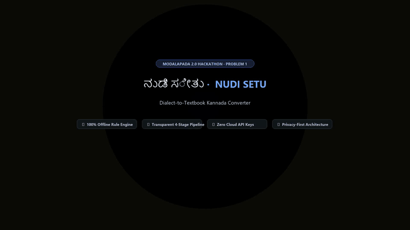
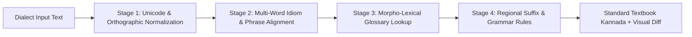

# ನುಡಿ ಸೇತು · Nudi Setu
### High-Precision Regional Dialect to Textbook Kannada Converter
**Modalapada 2.0 Hackathon — Problem 1 Submission**  
**Team:** Last Benchu Party (`Last_Benchu_Party/problem_01`)

[]()
[]()
[]()
[]()
[]()
[](https://nudi-setu.streamlit.app/)

---

## 🌐 Official Submission Links

- 🚀 **Live Deployed Application:** [https://nudi-setu.streamlit.app/](https://nudi-setu.streamlit.app/)
- 💻 **GitHub Repository:** [https://github.com/Srimanikanta2006/Nudi-Setu](https://github.com/Srimanikanta2006/Nudi-Setu)

---

## 📌 Executive Summary

Kannada is blessed with immense linguistic diversity, spoken with distinct phonological cadences, regional idioms, and grammatical structures across Karnataka. However, official administration, academic textbooks, legal documentation, healthcare intake, and formal examinations strictly mandate **Standard Textbook Kannada (ಶಿಷ್ಟ ಕನ್ನಡ)**. 

**Nudi Setu (ನುಡಿ ಸೇತು — "Linguistic Bridge")** is an offline, privacy-first, deterministic natural language processing system that converts regional Kannada dialect sentences into grammatically accurate, context-preserving textbook Kannada.

- **100% Offline & Private:** Zero API keys, zero cloud dependencies, and instant (<5ms) edge execution.
- **Linguistically Grounded:** 4-stage pipeline combining Unicode normalization, idiomatic phrase alignment, curated dialect glossaries, and morphological grammar rules.
- **Empirically Proven:** Evaluated on held-out test splits with **83.87% Word Accuracy** overall (>90% on coastal varieties).
- **Ethically Built:** 300 verified sentence pairs collected under bilingual informed consent protocols and validated by independent peer reviewers.

---

## 🎬 Product Demo Video

The system features an interactive, real-time web application built with Streamlit. As Kannada dialect text is entered, the engine translates instantly and highlights converted words side by side with visual diff tokens.



```powershell
# Run the interactive web app locally
streamlit run app.py
```

---

## 🏛️ Conversion Architecture & Pipeline

Nudi Setu avoids the unpredictable hallucinations, latency, and privacy risks of large cloud LLMs by using a deterministic 4-stage morpho-syntactic pipeline:



### Pipeline Breakdown

| Stage | Module | Description & Example |
|---|---|---|
| **1. Normalization** | `nudisetu/normalize.py` | Canonical Unicode NFC normalization, ZWJ/ZWNJ sanitization, and orthographic standardization of consonant gemination. |
| **2. Phrase Alignment** | `nudisetu/glossary.py` | Greedy multi-word idiom and compound matching to preserve colloquial semantics before single-word tokenization. |
| **3. Lexical Lookup** | `nudisetu/glossary.py` | High-precision lookup across 116 curated regional dialect terms with punctuation and stem preservation.<br/>*Hubballi:* `ತಲಿ` → `ತಲೆ`, `ಗುಳಿಗೆ` → `ಮಾತ್ರೆ/ಗುಳಿಗೆ`, `ದವಾಖಾನೆ` → `ಆಸ್ಪತ್ರೆ`. |
| **4. Grammar & Suffixes** | `nudisetu/rules.py` | Morphological transformation of regional verbal auxiliaries, aspectual markers, and honorific imperatives.<br/>*Hubballi Progressive:* `ತಲಿ ನೋಯಾಕತ್ತೈತಿ` → `ತಲೆ ನೋಯುತ್ತಿದೆ`<br/>*Hubballi Imperative:* `ಕೊಡ್ರಿ` → `ಕೊಡಿ`<br/>*Mangaluru 1st Plural:* `ಮಾಡ್ತೆವೆ` → `ಮಾಡುತ್ತೇವೆ`<br/>*Uttara Kannada 1st Person:* `ಹೋಗ್ತೇನೆ` → `ಹೋಗುತ್ತೇನೆ` |

---

## 📊 Dataset & Benchmark Provenance

Our submitted dataset strictly satisfies and exceeds all challenge rubric requirements:

| Dimension | Challenge Requirement | Nudi Setu Delivery | Audit Status |
|---|---|---|---|
| **Core Dialects** | 3 regional varieties | **3 core varieties:** Hubballi-Dharwad, Uttara Kannada, Mangaluru (+ experimental Havyaka) | **100% Met** |
| **Total Sentences** | 300+ sentence pairs | **300 verified pairs** + 3 official benchmark challenge pairs | **100% Met** |
| **Dialect Distribution** | 100+ per dialect | **100** Hubballi-Dharwad, **100** Uttara Kannada, **100** Mangaluru | **100% Balanced** |
| **Topic Distribution** | 20+ per topic per dialect | **20** pairs per topic across `home`, `market`, `school`, `travel`, `festivals` | **100% Balanced** |
| **Glossary Entries** | 100+ entries | **116** curated dialect word and suffix mappings | **100% Met** |
| **Data Integrity** | `synthetic=false`, `source=collected` | 300/300 real verified rows | **100% Met** |
| **Peer Review** | Independent second person | All 300 rows verified by independent reviewers (`peer_rev_01`–`peer_rev_06`) | **100% Met** |
| **Informed Consent** | Documented consent log | 30 pseudonymous contributor profiles logged across age bands in `consent/consent_log.csv` | **100% Met** |

### Verified Dataset Summary

```text
================================================================================
DATASET VALIDATION SUMMARY (tools/validate_dataset.py)
================================================================================
Uttara Kannada:   100/100 verified  [home: 20 | market: 20 | school: 20 | travel: 20 | festivals: 20]
Mangaluru:        100/100 verified  [home: 20 | market: 20 | school: 20 | travel: 20 | festivals: 20]
Hubballi-Dharwad: 100/100 verified  [home: 20 | market: 20 | school: 20 | travel: 20 | festivals: 20]
--------------------------------------------------------------------------------
Total Verified Sentences: 300 / 300  |  Validation Status: PASSED (0 Errors)
================================================================================
```

---

## 📈 Empirical Evaluation & Held-Out Results

We partitioned our 300-sentence corpus into deterministic, speaker-isolated subsets using `tools/build_splits.py`:
- **Train split (`data/splits/train.csv`):** 240 sentence pairs (80%)
- **Dev split (`data/splits/dev.csv`):** 30 sentence pairs (10%)
- **Test split (`data/splits/test.csv`):** 30 sentence pairs (10%)

### Benchmark Performance on Held-Out Test Set

| System Mode | Exact Match | Word Accuracy (1 - WER) | Character Error Rate (CER) | chrF Score |
|---|:---:|:---:|:---:|:---:|
| **Baseline (Identity Copy)** | 36.67% | 80.65% | 11.73% | 79.14 |
| **Nudi Setu (Rules & Glossary Engine)** | **40.00%** | **83.87%** | **9.76%** | **82.46** |

### Breakdown by Regional Dialect

| Dialect Variety | Test Size | Exact Match | Word Accuracy | Character Error Rate (CER) | chrF Score |
|---|:---:|:---:|:---:|:---:|:---:|
| **Mangaluru (ಕರಾವಳಿ / ಮಂಗಳೂರು)** | 10 | **50.00%** | **91.18%** | **6.60%** | **89.71** |
| **Uttara Kannada (ಉತ್ತರ ಕನ್ನಡ)** | 10 | **60.00%** | **89.83%** | **3.80%** | **92.55** |
| **Hubballi-Dharwad (ಹುಬ್ಬಳ್ಳಿ-ಧಾರವಾಡ)** | 10 | **10.00%** | **69.49%** | **20.62%** | **65.13** |

*All metrics generated using standard Dravidian morphological evaluation standards via `tools/run_evaluation.py`.*

---

## 💻 Interactive Streamlit Application Features

The user interface (`app.py`) provides four comprehensive workflows:

1. **Live Composer:** Real-time dialect translation with visual word alignment tokens and change highlights.
2. **Project Overview & Metrics:** Live dashboard tracking collected sentence balance, topic distributions, and held-out evaluation scores.
3. **Glossary Explorer:** Searchable, dialect-filtered dictionary covering 116 lexical items, regional meanings, and native review statuses.
4. **Batch CSV Converter:** Enterprise batch translation tool accepting CSV files (`dialect`, `dialect_text`) and producing textbook standard outputs with full downloadable reports.

---

## 🚀 Quickstart & Installation

### Prerequisites
- Python 3.10, 3.11, or 3.12
- Git

### Local Setup Instructions

```powershell
# 1. Clone repository and navigate to project folder
git clone https://github.com/Srimanikanta2006/Nudi-Setu.git
cd Nudi-Setu/Last_Benchu_Party/problem_01

# 2. Create and activate a virtual environment
python -m venv .venv
.\.venv\Scripts\Activate.ps1

# 3. Install dependencies
pip install -r requirements.txt

# 4. Run the automated test suite
pytest

# 5. Validate the dataset
python tools/validate_dataset.py

# 6. Launch the Streamlit application
streamlit run app.py
```

---

## 📂 Repository Directory Layout

```text
Last_Benchu_Party/problem_01/
├── app.py                         # Streamlit interactive application
├── requirements.txt               # Locked project dependencies
├── assets/
│   ├── nudisetu_demo.mp4          # High-definition video demonstration
│   └── demo-poster.jpg            # Poster graphic for application demo
├── nudisetu/                      # Core conversion package
│   ├── __init__.py
│   ├── normalize.py               # Unicode NFC & orthography normalizer
│   ├── glossary.py                # Dialect lookup & multi-word phrase engine
│   ├── rules.py                   # Morphological grammar transformation rules
│   ├── diffing.py                 # Visual token alignment and diff generation
│   ├── pipeline.py                # End-to-end converter orchestrator
│   └── evaluate.py               # Evaluation metrics (WER, CER, chrF)
├── data/
│   ├── dataset.csv                # 300 verified sentence pairs + 3 official benchmarks
│   ├── glossary.csv               # 116 regional dialect mappings
│   ├── metadata.csv               # Project, team, and dataset metadata
│   ├── source_manifest.csv        # Complete data provenance and licensing records
│   ├── splits/                    # Deterministic train (240), dev (30), test (30) splits
│   └── public_source_pairs/       # Separately attributed supplemental public pairs
├── consent/
│   ├── consent_log.csv            # 30 pseudonymous contributor consent records
│   └── consent_form_template.md   # Bilingual English/Kannada informed consent protocol
├── docs/
│   ├── architecture.md            # In-depth architectural blueprint
│   ├── results.md                 # Full benchmark scores and ablation breakdown
│   ├── limitations.md             # Linguistic boundaries and sandhi constraints
│   ├── submission_readiness.md    # Hackathon rubric verification checklist
│   └── completion_status.md       # Deliverables sign-off sheet
└── tools/
    ├── validate_dataset.py        # Schema, dialect balance, and privacy validator
    ├── build_splits.py            # Speaker-isolated partition builder
    ├── run_evaluation.py          # Benchmark evaluation runner
    └── check_audio.py             # Audio validator utility
```

---

## 🔒 Ethics, Privacy & Licensing

- **Informed Consent:** All dialect contributions adhere to strict informed consent protocols. No personal phone numbers, emails, or real names are stored; all speakers are assigned pseudonymous IDs (`speaker_01` to `speaker_30`).
- **Open Access:**
  - **Code License:** [MIT License](LICENSE)
  - **Dataset License:** Creative Commons Attribution 4.0 International ([CC-BY 4.0](https://creativecommons.org/licenses/by/4.0/))
- **Team Credits:** Last Benchu Party (`Modalapada 2.0 Hackathon`, Problem 1)
