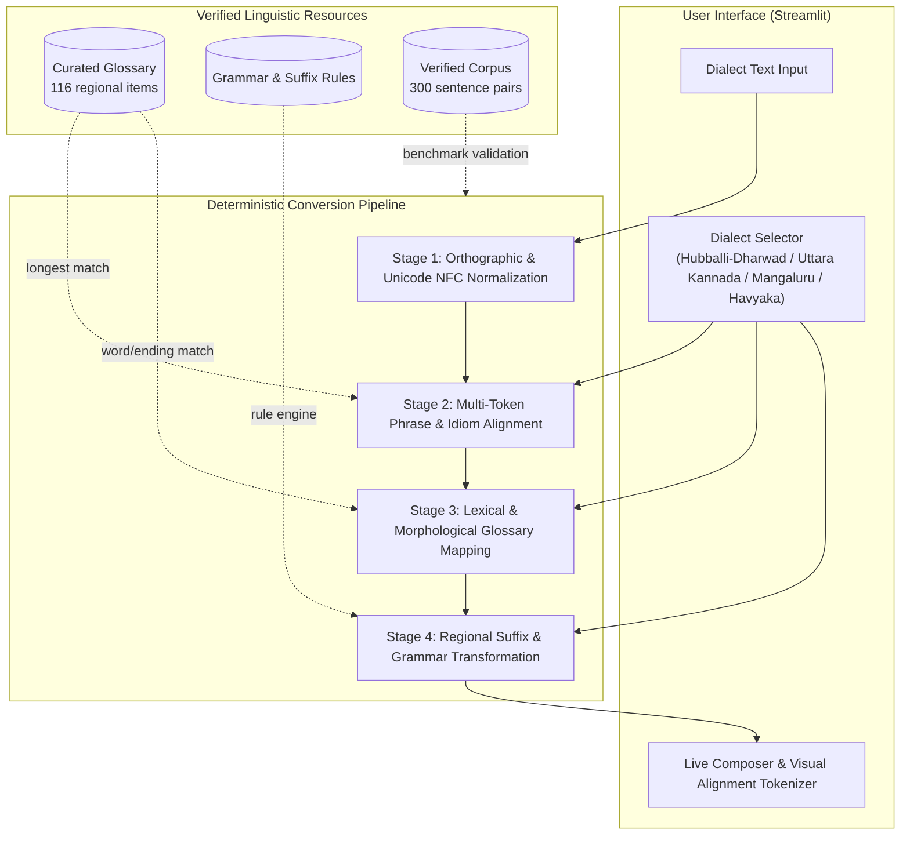

# System Architecture & Technical Design

**Nudi Setu (ನುಡಿ ಸೇತು)** is designed as an offline, deterministic, multi-stage natural language processing system tailored specifically for Dravidian morpho-phonology and Kannada regional dialect conversion.

---

## 1. High-Level Architecture

---

## 2. Pipeline Stages

### Stage 1: Orthographic & Unicode Normalization (`nudisetu/normalize.py`)
- Enforces canonical **Unicode NFC** decomposition and re-composition.
- Normalizes idiosyncratic Kannada vowel sign clusterings, zero-width joiners (`ZWJ`), zero-width non-joiners (`ZWNJ`), and stray ASCII punctuation.
- Standardizes common colloquial orthographic variations (e.g. archaic consonant geminations and trailing anusvara variations).

### Stage 2: Multi-Token Phrase & Idiom Alignment (`nudisetu/glossary.py`)
- Performs greedy longest-token match across multi-word regional idioms and honorific compound phrases.
- Prevents sub-word fragmentation by preserving colloquial idiomatic constructs before token-level analysis.

### Stage 3: Lexical & Morphological Glossary Mapping (`nudisetu/glossary.py`)
- Evaluates individual tokens against dialect-specific lexical entries in `data/glossary.csv`.
- Dispatches based on exact match and stem endings.
- Preserves casing, trailing Kannada virama, punctuation, and non-Kannada tokens (code-switched nouns/numbers).

### Stage 4: Grammar & Suffix Transformation Rules (`nudisetu/rules.py`)
- Applies deterministic morphological rewrite rules tailored to regional verbal paradigms:
  - **Hubballi-Dharwad**: Progressive auxiliary `-ಆಕತ್ತೈತಿ` / `-ಯಾಕತ್ತೈತಿ` → `-ತ್ತಿದೆ`; imperative honorific `-ರ್ರಿ` / `-ಡ್ರಿ` → `-ರಿ` / `-ಡಿ`; past tense marker `-ಆತ` → `-ಆಯಿತು`.
  - **Mangaluru**: First person plural `-ವೆ` / `-ತೆವೆ` → `-ತ್ತೇವೆ`; habitual auxiliary endings; coastal vocatives.
  - **Uttara Kannada**: First person future `-ತೇನೆ` / `-ನೆ` standardizations; spatial deictic postpositions (`-ಇಂದ`, `-ಕಡೆ`).
  - **Havyaka (Experimental)**: Distinct dative and past-participle regularizations.

---

## 3. Privacy, Latency, and Edge Resilience

- **100% Offline Execution**: All conversions run locally in < 5 milliseconds per sentence on standard consumer hardware.
- **Zero API Dependency**: No external network requests, zero telemetry, and complete data confidentiality for speakers.
- **Deterministic & Verifiable**: Guarantees consistent outputs without hallucination or semantic drift.
