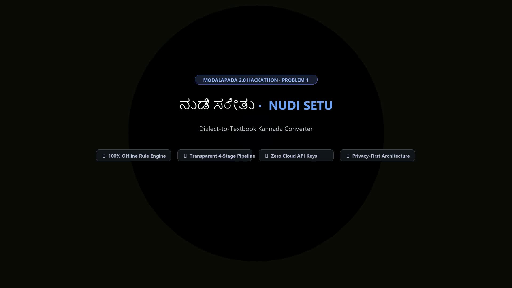

# Nudi Setu (ನುಡಿ ಸೇತು)

**Kannada dialect → textbook Kannada** · Modalapada 2.0 Hackathon · Problem 1

[](team_XX/problem_01/assets/nudisetu_demo.mp4)

**Prototype status:** the app runs offline, but this is not a trained or accuracy-validated translation model. The starter dataset contains 3 challenge examples and 60 synthetic examples; there are **0/300 real, consent-backed speaker pairs**. Review the [submission-readiness checklist](team_XX/problem_01/docs/submission_readiness.md) before treating this project as a completed challenge submission.

## Run the demo locally

Python 3.10 or later is required. From the repository root, run these commands in PowerShell:

```powershell
cd team_XX/problem_01
python -m venv .venv
.\.venv\Scripts\Activate.ps1
python -m pip install -r requirements.txt
streamlit run app.py
```

The app opens at `http://localhost:8501`. Kannada text is converted automatically as it is entered. No API key, AI service, or network connection is required for conversion.

## What the app does

The converter normalizes Unicode text, applies known phrase and word mappings, applies conservative grammar rules, and shows the changed words side by side. It supports the three challenge varieties: **Uttara Kannada, Mangaluru, and Hubballi-Dharwad**. An additional **experimental Havyaka** option uses a small set of published examples and is not part of the three-dialect collection target.

The interface also includes an overview, glossary browser, collection resources, and batch CSV conversion. The batch input format requires `dialect` and `dialect_text` columns; the downloaded file adds `standard_text`.

If no known mapping applies, the app leaves the sentence unchanged. A mapped result can still be wrong or lose context: 61 of the 116 glossary entries need native-speaker review, and conversion accuracy has not been measured against an independently reviewed held-out set.

## Data and provenance

| Material | Current status | How it is used |
|---|---|---|
| `data/dataset.csv` | 3 official challenge examples + 60 explicitly synthetic examples | Demo and pipeline checks; not real speaker collection |
| `data/glossary.csv` | 116 entries; 61 marked `needs_native_check` | Rule lookup; provisional entries should be reviewed |
| `data/unverified_sentence_pair_candidates.csv` | 118 deduplicated pairs from pasted AI-generated batches | Audit/download only; not sentence-pair training data |
| `data/public_source_pairs/` | 4 separately attributed examples | Exact-match supplement; native review pending; TV9 reuse terms are not verified |
| `data/public_sources/openslr79/` | General Kannada transcript indexes without dialect labels | Kept separate; not used as dialect conversion pairs |

There are no trained model weights. `data/source_manifest.csv` lists the origins and terms for included material. `data/metadata.csv` records the current counts and still has a `Team XX` placeholder. Never describe generated examples, public text, or general Kannada transcripts as consented Nudi Setu speaker data.

## Project map

```text
team_XX/problem_01/
├── app.py                         Streamlit application
├── nudisetu/                      Offline conversion and evaluation code
├── data/
│   ├── dataset.csv                Official and synthetic starter rows
│   ├── glossary.csv               Mappings with review status
│   ├── metadata.csv               Team/project metadata
│   └── source_manifest.csv         Provenance and reuse notes
├── consent/                       Consent template and empty log
├── docs/                           Audits, architecture, and submission status
└── tools/                          Dataset, audio, and evaluation utilities
```

The `XX` folder name must be replaced with the assigned team number before submission.

## Checks and submission

Run `python tools/validate_dataset.py` from `team_XX/problem_01` to check the required schema, consent, review, and collection targets. With the current empty real-speaker dataset, it reports 0/300 and exits nonzero as expected. Run `python -m pytest -q` to execute the project test suite before publishing.

The submission instructions require a GitHub repository link, a demo-video Google Drive link, and a Google Drive link for the permitted dataset sources and consent records. The current demo MP4 is linked above and included in the project; upload it to the team Drive too if the organizers require that channel. The repo is not data-complete and still needs its team number, real consented pairs, second-person review, and Drive links.

### Deploy on Streamlit Community Cloud

1. Sign in at [share.streamlit.io](https://share.streamlit.io) using the GitHub account that can access this repository.
2. Choose **Create app**, select `Srimanikanta2006/Nudi-Setu`, branch `main`, and app file path `team_XX/problem_01/app.py`.
3. Deploy. This app does not need Streamlit secrets or an API key.

The project folder is nested to match the hackathon's required `team_XX/problem_01/` layout. Replace `XX` with the assigned team number when known; until then use the path exactly as committed.

See the [detailed checklist](team_XX/problem_01/docs/submission_readiness.md), [limitations](team_XX/problem_01/docs/limitations.md), and [source manifest](team_XX/problem_01/data/source_manifest.csv).
