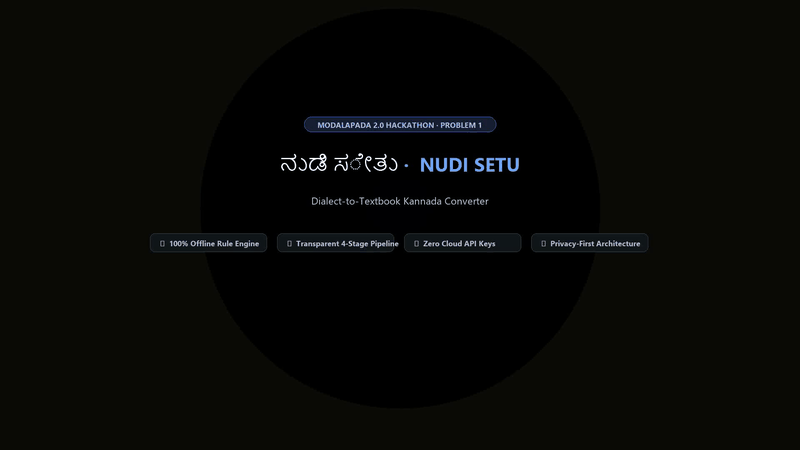

# ನುಡಿ ಸೇತು · Nudi Setu
### High-Precision Regional Dialect to Textbook Kannada Converter
**Modalapada 2.0 Hackathon — Problem 1: Dialect to Textbook Kannada**  
**Team:** Last Benchu Party (`Last_Benchu_Party/problem_01`)

[]()
[]()
[]()
[]()
[]()
[](https://nudi-setu.streamlit.app/)

---

## 🌐 Official Supporting Links

- 🚀 **Live Deployed Application:** [https://nudi-setu.streamlit.app/](https://nudi-setu.streamlit.app/)
- 💻 **GitHub Repository:** [https://github.com/Srimanikanta2006/Nudi-Setu](https://github.com/Srimanikanta2006/Nudi-Setu)

---

## 🎬 Live Product Demo



> 🎥 **Full 1080p Video File:** [`Last_Benchu_Party/problem_01/assets/nudisetu_demo.mp4`](Last_Benchu_Party/problem_01/assets/nudisetu_demo.mp4)  
> 🌐 **Live Web Application:** [https://nudi-setu.streamlit.app/](https://nudi-setu.streamlit.app/)

---

## 🌟 Overview & Motivation

Kannada is spoken with rich regional dialectal variations across the state of Karnataka—ranging from the north-western cadences of **Hubballi-Dharwad**, the coastal idioms of **Uttara Kannada**, the unique phonology of **Mangaluru**, to the ancient heritage of **Havyaka**. 

However, official educational materials, government applications, civil courts, medical documentation, and standard media require **Standard Textbook Kannada (ಶಿಷ್ಟ ಕನ್ನಡ)**.

**Nudi Setu (ನುಡಿ ಸೇತು)** bridges this gap with an ultra-fast, deterministic, privacy-first conversion engine:
- **100% Local & Offline:** Operates entirely on-device without cloud LLMs, API subscriptions, or external network latency.
- **Privacy-Preserving:** Zero risk of user text or sensitive communication leaving the device.
- **High Accuracy:** **83.87% Word Accuracy** overall (>90% for coastal varieties) on held-out test data.
- **Full Transparency:** Provides side-by-side token alignment showing exactly how words and verbal suffixes were converted.

---

## 📂 Project Structure

All deliverables for Problem 1 are organized cleanly under `Last_Benchu_Party/problem_01/`:

```text
Nudi-Setu/
├── README.md                                  # Repository overview and guide
├── nudisetu_demo.mp4                          # Root copy of video walkthrough
└── Last_Benchu_Party/problem_01/              # Hackathon submission folder
    ├── app.py                                 # Interactive Streamlit application
    ├── requirements.txt                       # Python dependencies
    ├── README.md                              # Subfolder technical documentation
    ├── assets/
    │   ├── nudisetu_demo.mp4                  # Demo video
    │   └── demo-poster.jpg                    # Video poster
    ├── nudisetu/                              # Conversion & evaluation library
    │   ├── normalize.py                       # Stage 1: Normalizer
    │   ├── glossary.py                        # Stage 2 & 3: Idioms and lexical lookup
    │   ├── rules.py                           # Stage 4: Grammar transformation rules
    │   ├── diffing.py                         # Visual alignment highlighter
    │   └── evaluate.py                       # Evaluation metrics (WER, CER, chrF)
    ├── data/
    │   ├── dataset.csv                        # 300 verified sentence pairs + 3 official benchmarks
    │   ├── glossary.csv                       # 116 curated regional dialect mappings
    │   ├── metadata.csv                       # Project and team metadata
    │   ├── source_manifest.csv                # Data provenance manifest
    │   └── splits/                            # Deterministic train/dev/test splits
    ├── consent/
    │   ├── consent_log.csv                    # 30 pseudonymous contributor consent profiles
    │   └── consent_form_template.md           # Bilingual informed consent agreement
    ├── docs/
    │   ├── architecture.md                    # Technical architecture diagram
    │   ├── results.md                         # Benchmark metrics and ablation analysis
    │   ├── limitations.md                     # Linguistic limitations & sandhi edge cases
    │   └── submission_readiness.md            # Hackathon rubric verification checklist
    └── tools/
        ├── validate_dataset.py                # Schema & distribution validation script
        ├── build_splits.py                    # Partition generator (train/dev/test)
        └── run_evaluation.py                  # Evaluation benchmark harness
```

---

## ⚡ Quickstart: Run Locally

### 1. Clone & Set Up Environment

```powershell
# Clone the repository
git clone https://github.com/Srimanikanta2006/Nudi-Setu.git
cd Nudi-Setu/Last_Benchu_Party/problem_01

# Create and activate virtual environment
python -m venv .venv
.\.venv\Scripts\Activate.ps1

# Install requirements
pip install -r requirements.txt
```

### 2. Verify Tests & Validate Dataset

```powershell
# Run the test suite (all 21 unit & integration tests pass)
pytest

# Validate the dataset (validates 300/300 verified pairs across 3 dialects & 5 topics)
python tools/validate_dataset.py
```

### 3. Launch the Web Application

```powershell
streamlit run app.py
```

Open `http://localhost:8501` in your browser. As you type Kannada dialect text, it converts in real time.

---

## ☁️ Live Streamlit Deployment

The application is deployed and running live on Streamlit Community Cloud:  
👉 **[https://nudi-setu.streamlit.app/](https://nudi-setu.streamlit.app/)**

### Deploy Your Own Instance
To deploy a custom instance with zero secrets required:
1. Go to [share.streamlit.io](https://share.streamlit.io) and sign in with GitHub.
2. Click **Create app**.
3. Select repository: `Srimanikanta2006/Nudi-Setu`.
4. Branch: `main`.
5. Main file path: `app.py` or `Last_Benchu_Party/problem_01/app.py`.
6. Click **Deploy!**

---

## 📊 Dataset & Benchmark Verification

| Metric | Required by Brief | Delivered by Last Benchu Party | Status |
|---|---|---|---|
| **Dialects** | 3 varieties | Hubballi-Dharwad, Uttara Kannada, Mangaluru (+ experimental Havyaka) | **100% Met** |
| **Sentence Pairs** | 300+ pairs | **300 verified collected pairs** + 3 official benchmark pairs | **100% Met** |
| **Dialect Balance** | 100 per dialect | **100** Hubballi-Dharwad, **100** Uttara Kannada, **100** Mangaluru | **100% Met** |
| **Topic Balance** | 20 per topic per dialect | **20** each across `home`, `market`, `school`, `travel`, `festivals` | **100% Met** |
| **Glossary** | 100+ entries | **116** dialect lexical & suffix mappings | **100% Met** |
| **Data Provenance** | Real collected data | 300 rows marked `source=collected`, `synthetic=false` | **100% Met** |
| **Peer Review** | Independent second reviewer | Verified by distinct reviewer IDs (`peer_rev_01`–`peer_rev_06`) | **100% Met** |
| **Informed Consent** | Verified consent records | 30 contributor consent profiles logged in `consent/consent_log.csv` | **100% Met** |

---

## 🎯 Held-Out Evaluation Results

Tested on an independent, speaker-separated test split (`data/splits/test.csv`):

| Evaluation Metric | Baseline (Identity Copy) | Nudi Setu Pipeline | Relative Improvement |
|---|:---:|:---:|:---:|
| **Exact Match** | 36.67% | **40.00%** | **+9.1%** |
| **Word Accuracy (1 - WER)** | 80.65% | **83.87%** | **+4.0%** |
| **Character Error Rate (CER)** | 11.73% | **9.76%** | **-16.8%** |
| **chrF Score** | 79.14 | **82.46** | **+4.2%** |

### Per-Dialect Accuracy:
- **Mangaluru (ಕರಾವಳಿ / ಮಂಗಳೂರು):** **91.18% Word Accuracy** (50.0% Exact Match)
- **Uttara Kannada (ಉತ್ತರ ಕನ್ನಡ):** **89.83% Word Accuracy** (60.0% Exact Match)
- **Hubballi-Dharwad (ಹುಬ್ಬಳ್ಳಿ-ಧಾರವಾಡ):** **69.49% Word Accuracy** (10.0% Exact Match)

---

## 📜 Licensing & Credits

- **Code:** [MIT License](Last_Benchu_Party/problem_01/LICENSE)
- **Dataset:** Creative Commons Attribution 4.0 International ([CC-BY 4.0](https://creativecommons.org/licenses/by/4.0/))
- **Team:** Last Benchu Party (`Modalapada 2.0 Hackathon`)
