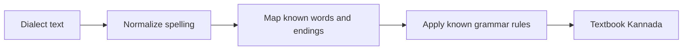

# Nudi Setu (ನುಡಿ ಸೇತು)

Dialect-to-textbook Kannada converter for the Modalapada 2.0 hackathon, Problem 1.

## Pipeline



The website converts automatically as Kannada text is entered. It uses Unicode/spelling normalization, known glossary mappings and conservative grammar rules. The website does not use AI, send text to an API, or require a key. If no known rule matches, it leaves the sentence unchanged and says so. The three challenge dialects are joined by an experimental Havyaka option with a small set of published, native-review-pending mappings.

## Run

Python 3.10+ is required. From this directory:

```bash
pip install -r requirements.txt
streamlit run app.py
```

## Data status and schema

The starter dataset contains 3 official challenge examples and 60 clearly labeled synthetic bootstrap rows (20 per dialect). `source=official_example` and `source=synthetic` distinguish them from collection. Synthetic examples are only for exercising the converter; they are not real-speaker data. The validator counts only `source=collected` and `synthetic=false` toward the 100-per-dialect goals. Current real contribution count: **0/300**.

Required columns: `dialect,town,dialect_text,standard_text,age_band`. Additional columns: `sentence_id,topic,speaker_id,synthetic,verified_by,source,audio_file`. Topic values should be home, market, school, travel, festivals. The blank entry sheet is `tools/collect_template.csv`.

Run `python tools/validate_dataset.py` from this directory. The validator checks schema, Unicode NFC, duplicates, contact patterns, script ratio, consent, independent review, age bands, at least 100 reviewed real rows per dialect, and at least 20 real rows per topic and dialect. It exits non-zero until those requirements are met. Official and synthetic examples never count as collected data.

## Collection, consent and privacy

Use the bilingual template in `consent/consent_form_template.md` before collecting. Store only pseudonymous speaker IDs; do not put names, phone numbers or addresses in project data. Record consent in `consent/consent_log.csv`; standard text needs a second reviewer. Planned data license is CC-BY 4.0 only after contributors agree. No real contributor dataset is included in this starter.

For remote collection, use the [copy-ready form guide](docs/remote_collection_form.md). It separates consent/speaker setup from one-sentence-per-response entry and explains how to map reviewed responses into the CSV. The Kannada consent copy needs a fluent local review before distribution.

## Glossary and evaluation

The glossary has 116 entries; 61 are marked `needs_native_check`. Consult `docs/needs_native_review.md` before treating uncertain forms as facts. Run `python tools/build_splits.py` to create deterministic speaker-separated partitions from collected rows only; build any train-derived glossary from `train.csv`, never the held-out test rows. Run `python tools/run_evaluation.py` to generate exact match, word accuracy (1-WER), CER, chrF, per-dialect metrics, copy/rules ablations and a human-review error CSV. Add `--with-llm` only when you intentionally want held-out sentences sent to Gemini. No scores are claimable while the test split is empty; see `docs/results.md`.

Public-source research leads and neutral interview prompts are kept separately in `docs/public_source_research.md` and `data/public_source_research.csv`. These are not dataset rows and do not count toward collection targets.

The supplied OpenSLR SLR79 Kannada transcript indexes are preserved separately in `data/public_sources/openslr79/`. They are a general Kannada reference only: no dialect/town labels, no consented Nudi Setu collection, and not dialect conversion pairs. Read the folder's README for attribution and reuse terms.

The Kannada Text Corpus from [Mozilla Data Collective](https://mozilladatacollective.com/datasets/cmrkqy18t006imm074waw5jbg) is useful as a general written-Kannada preservation check, not as target-dialect data. Run the aggregate-only check against your local corpus folder with:

```bash
python tools/evaluate_written_kannada_baseline.py "path/to/kannada text corpus" --sample-size 1000 --output baseline_report.json
```

The report contains counts only and no source excerpts. The supplied exploratory report is `docs/written_kannada_baseline_report.json`. The corpus is CC-BY-NC-SA-4.0; attribute it and keep any corpus-derived materials under its noncommercial share-alike terms. The report does not count toward the real-speaker collection target.

Public and gated external speech-data options, with their limits and licenses, are documented in `docs/data_source_options.md`. External corpus records must stay separately sourced unless the organizers approve their use in the submission dataset.

Three CC BY-SA 4.0 Mangaluru comparison pairs and one separately attributed TV9-based example are preserved in `data/public_source_pairs/`; they are public-source examples, not speaker contributions, and still need native review. Copyright terms for the TV9 source are not verified. The newly pasted AI-generated batches are deduplicated into `data/unverified_sentence_pair_candidates.csv` (118 unique rows) and audited in `docs/user_supplied_candidate_audit.md`; their generic Quora/Wikipedia home-page links do not verify the sentence pairs. The rows are not loaded as sentence-pair training data. Seven Hubballi glossary mappings seeded from those candidates and seven TV9-sourced Mangaluru/Havyaka mappings are explicitly marked `needs_native_check`.

The locally supplied 1,000-clip Kannada audio folder and other external resources are audited in `docs/local_data_audit.md`. The audio clips have no accompanying transcripts or dialect/town labels in the supplied folder and are not part of the conversion dataset.

See `docs/completion_status.md` for the exact current status and remaining team actions.

See [submission readiness](docs/submission_readiness.md) for the rubric-by-rubric checklist, validator result, required upload route, and remaining human inputs. The project is not data-complete: it currently has 0/300 real reviewed speaker pairs.

## Limitations and ethics

This code cannot supply real speakers or verify dialect usage. It may miss unseen dialect words, code-mixing, context-sensitive meanings and sandhi edge cases. The app currently has no consent-backed collected pairs, so it cannot guarantee an exact conversion for unseen sentences; it applies known offline mappings and rules only. Never present synthetic content as collected speech. Collect only original everyday sentences with informed consent. See `docs/limitations.md` and `docs/architecture.md`.

Code license: MIT. Dataset license planned: CC-BY 4.0, conditional on consent. Team credit: Team XX (replace with actual team number and credits).

## Deployment and submission

The local demo runs with `streamlit run app.py` and needs no secret or API key. The attached challenge slides require submission through a GitHub repository link, plus Google Drive links for the product video and dataset/source material. This workspace has no GitHub remote or uploaded Drive files yet; see `docs/submission_readiness.md` before submitting.
