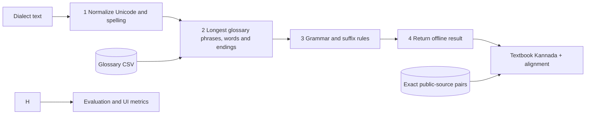

# Architecture

The website conversion is deterministic and offline. Glossary matches precede regex rules. It does not call an AI model or transmit the sentence to a service. Exact public-source pairs are a separate, explicitly cited lookup and are never treated as collected or training data.

There are no consent-backed collected training rows yet, so the current rules cannot make arbitrary new sentences exact. Unseen vocabulary/context needs a verified mapping or a native speaker correction before the system can reliably convert it.
